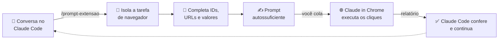

<div align="center">

# 🧠 ➜ 🌐 prompt-extensao

### O Claude Code pensa. O Claude in Chrome clica. Você só cola.

**Uma skill do Claude Code que transforma a tarefa da conversa num prompt pronto para o Claude in Chrome executar sozinho.**


</div>

---

## 🤔 O problema

O Claude Code resolve o código, o banco, o deploy... e aí trava em:

> *"Agora é só você entrar no painel da Supabase, ir em Authentication › Hooks, ativar o `claims_do_token`, depois em Settings › API expor os schemas `shenzhen` e `trato`, depois mudar o JWT para 600 s, depois..."*

Clicar em dashboards é a última milha que o terminal não alcança. Copiar instruções na mão é chato, e qualquer coisa esquecida (um ID, um valor exato) faz a extensão do navegador se perder.

## ✨ A solução

```
/prompt-extensao
```

Um comando. A skill:

1. 🎯 **Identifica a tarefa** que está sendo falada agora na conversa (ou o projeto inteiro, se você pedir).
2. 🔎 **Completa os detalhes** que faltam: URLs, IDs de projeto, schemas, valores de configuração, puxando da memória e dos arquivos só o necessário.
3. ✍️ **Escreve um prompt autossuficiente**: objetivo, contexto, onde clicar, passos numerados com valores exatos, como conferir e limites de segurança.
4. 📋 **Entrega pronto pra colar** no painel lateral do Claude in Chrome e salva uma cópia em `~/.claude/prompts-extensao/`.
5. 🔁 **Fecha o ciclo**: você cola a resposta da extensão de volta, o Claude Code confere e segue o trabalho.

## 🔄 Como funciona



## 🧩 Anatomia do prompt gerado

| Seção | Para quê |
|---|---|
| **Objetivo** | O que precisa ser verdade quando terminar |
| **Contexto** | O mínimo para a extensão entender o porquê |
| **Onde** | URLs exatas + qual conta/projeto/ID |
| **Passos** | Ações concretas, com valores exatos (`600`, não "uns 10 minutos") |
| **Como conferir** | O que deve aparecer na tela quando der certo |
| **Limites** | O que ela **não** pode fazer sem perguntar |
| **No fim, me responda** | O relatório que o Claude Code precisa para continuar |

## 🛡️ Segurança embutida

Todo prompt sai com trava de fábrica:

- 🔐 **Nenhum segredo vai no prompt**: senhas, `service_role`, tokens e chaves privadas ficam de fora, sempre.
- 🛑 **Para antes do irreversível**: apagar, pagar, comprar, convidar gente? Só com confirmação.
- 👀 **Não improvisa**: tela diferente do esperado = para e reporta.
- 🎯 **Escopo fechado**: nada fora da lista de passos.

## 🚀 Instalação

```bash
git clone https://github.com/rodricoleman/prompt-extensao ~/.claude/skills/prompt-extensao
```

Pronto. Na próxima sessão do Claude Code, `/prompt-extensao` já aparece.

## 🕹️ Uso

| Comando | O que acontece |
|---|---|
| `/prompt-extensao` | Pega a tarefa que está sendo falada na conversa |
| `/prompt-extensao ligar o domínio na Vercel` | Gera o prompt para essa tarefa específica |
| `/prompt-extensao tudo que falta do projeto` | Varre memória e planos atrás de todas as pendências de navegador |

Ou só peça em linguagem natural: *"manda isso pra extensão"*, *"gera o prompt pro Chrome"*.

## 🏗️ Funciona com

Qualquer coisa que tenha painel web: **Supabase**, **Vercel**, **Cloudflare**, **Google Workspace**, **GitHub**, registradores de domínio, gateways de pagamento (só leitura, a menos que você mande), e o que mais aparecer.

---

<div align="center">

**Feito com 🤖 Claude Code, para o Claude in Chrome, por um humano com preguiça de clicar.**

</div>
